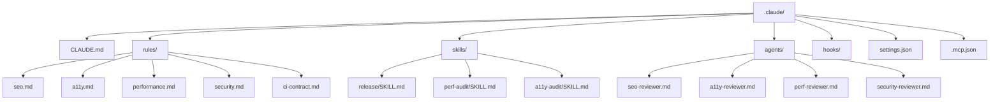

# Bootstrapping a Mostly-Static Website Template Repo With CI, Quality Gates, and Claude Code Governance

## Executive summary

This report proposes a template repository that produces a fast, accessible, SEO-friendly, mostly-static site—using HTML-first patterns. The design emphasizes progressive enhancement: links and forms work without JavaScript.

The CI blueprint uses deterministic quality gates (linters, HTML validation, accessibility testing, Lighthouse CI budgets, security scanning, secret scanning, link checking) to prevent regressions. Lighthouse CI is specifically intended for performance monitoring and regression prevention—tracking audits over time and enforcing thresholds in continuous integration. citeturn18search15turn16search3turn18search27

Security and supply-chain hygiene are treated as “first-class build outputs”: dependency review blocks vulnerable dependency deltas in pull requests, CodeQL scans code (and can also scan workflows), OSV scanning checks known vulnerable dependencies, and secret scanners prevent credential leakage. GitHub security guidance stresses least-privilege for the workflow `GITHUB_TOKEN` (default read-only, then add job-level permissions), which is implemented in all workflows below. citeturn2search2turn2search3turn15search5turn21search2turn21search6

Finally, the template adds a governance layer using Claude Code (from entity["company","Anthropic","ai research company"]): project-wide instructions via `CLAUDE.md` and `.claude/rules/`, reusable skills and subagents for code review and audits, and deterministic hooks that can block dangerous commands or enforce “run CI locally” behavior. Claude Code documentation is explicit that `CLAUDE.md` is contextual guidance (not enforced configuration), while hooks provide deterministic control points that can block actions. citeturn4view0turn5view0turn6view0turn7view0

## Design goals and reference stack

The template is optimized for a “mostly-static” site where HTML is the primary artifact, CSS handles layout and responsiveness, and JavaScript is minimal. Modern performance and crawlability requirements imply treating SEO, Core Web Vitals, and accessibility as build-time constraints rather than afterthoughts.

### Baseline standards and primary sources

The build and governance defaults are anchored in these authoritative references:

- Lighthouse audits (performance, accessibility, best practices, SEO) and Lighthouse CI for regression prevention. citeturn16search3turn16search7turn18search15
- Core Web Vitals definitions and measurement guidance (including field measurement via the `web-vitals` library). citeturn13search17turn1search32turn13search2
- Sitemap protocol and Google’s sitemap and canonicalization guidance. citeturn16search0turn16search4turn16search1
- Open Graph protocol for link previews. citeturn16search2
- Accessibility testing informed by WCAG and practical constraints: automated tools only catch a subset of issues (notably, aix/pa11y guidance cites limited coverage), so CI must combine automated checks plus manual review practices for critical user flows. citeturn12search3
- Security headers guidance from MDN and OWASP Secure Headers / CSP references, plus ongoing scanning with Mozilla’s HTTP Observatory. citeturn20search30turn13search11turn13search15turn18search1turn13search24
- Hosting header configuration capabilities: Netlify and Cloudflare Pages both support `_headers`-style artifacts, while GitHub Pages is widely documented as not supporting custom response headers (so the template treats “custom headers” as provider-dependent). citeturn14search2turn14search1turn20search1

### Interactivity constraints

JavaScript is used only when it improves UX without changing the "hyperlink and form" model. The template defaults to standard navigation and forms with no client-side routing.

## Repository structure and starter files

The template is split into “source” (human-authored) and “dist” (deployable). It defaults to Eleventy + esbuild as a lightweight build stack but includes an alternative “swap the SSG” path (Hugo, etc.) without changing CI semantics.

### Repository layout

```mermaid
flowchart TB
  R[repo root]
  R --> GH[.github/workflows]
  R --> SRC[src/]
  R --> SCRIPTS[scripts/]
  R --> DOCS[docs/]
  R --> CLAUDE[.claude/]
  R --> DIST[dist/ (generated)]

  SRC --> INCLUDES[_includes/layouts + partials]
  SRC --> DATA[_data/site.json]
  SRC --> PAGES[pages/]
  SRC --> ASSETS[assets/css, assets/js, assets/img]
  SRC --> STATIC[static passthrough files]

  GH --> CI[ci.yml]
  GH --> LH[lighthouse.yml]
  GH --> SEC[security.yml]
  GH --> DEPLOY[deploy.yml]
  GH --> MON[monitor.yml]
```

### Why Eleventy (default) and how to swap it

Eleventy’s model—inputs compiled to an output directory—fits static-site workflows and supports simple configuration via a root config file. Eleventy CLI usage and configuration patterns are documented in its official docs. citeturn19search0turn19search4turn19search12

If you prefer Hugo, its `hugo` command includes `--minify` and is explicitly intended as the main build command. citeturn19search1  
The CI below stays the same: “build to dist, then lint/test/scan dist.”

### Starter files you should include

#### `src/_data/site.json`

A single source of truth for domain, locale, defaults:

```json
{
  "url": "https://example.com",
  "lang": "en-US",
  "title": "Site Title",
  "description": "A fast, accessible, mostly-static website.",
  "author": "Your Team",
  "socialImage": "/assets/img/social-card.png"
}
```

#### `src/_includes/layouts/base.njk`

Key SEO/A11y/perf scaffolding built into the default layout:

```html
<!DOCTYPE html>
<html lang="{{ site.lang }}">
  <head>
    <meta charset="utf-8" />
    <meta name="viewport" content="width=device-width, initial-scale=1" />

    <title>{{ title }} · {{ site.title }}{{ site.title }}</title>
    <meta name="description" content="{{ description or site.description }}" />

    {# Canonical (avoid duplicate URL variants) #}
    <link rel="canonical" href="{{ site.url }}{{ page.url }}" />

    {# Open Graph (rich link previews) #}
    <meta property="og:site_name" content="{{ site.title }}" />
    <meta property="og:title" content="{{ title or site.title }}" />
    <meta property="og:description" content="{{ description or site.description }}" />
    <meta property="og:url" content="{{ site.url }}{{ page.url }}" />
    <meta property="og:type" content="website" />
    <meta property="og:image" content="{{ site.url }}{{ site.socialImage }}" />

    {# Minimal CSS, no frameworks #}
    <link rel="stylesheet" href="/assets/css/main.css" />
  </head>
  <body>
    <a class="skip-link" href="#content">Skip to content</a>

    

    <main id="content">{{ content | safe }}</main>

    
    <script src="/assets/js/main.js" defer></script>
  </body>
</html>
```

Canonical tags are a recommended mechanism for consolidating duplicates (for example, `rel="canonical"`), and Google documents multiple canonicalization signals and their strength. citeturn16search1turn16search5  
Open Graph is specified by the Open Graph protocol and is widely used for rich previews. citeturn16search2  
Using `hx-boost` aligns with progressive enhancement: it “boosts” normal anchors/forms but preserves normal navigation when JS is disabled. citeturn19search2

#### `src/robots.txt.njk`

```txt
User-agent: *
Allow: /

Sitemap: {{ site.url }}/sitemap.xml
```

Google documents building and submitting sitemaps and supports sitemap formats defined by the sitemap protocol. citeturn16search4turn16search0

#### `scripts/generate-sitemap.mjs`

A minimal sitemap generator aligned to the sitemap protocol:

```js
import { promises as fs } from "node:fs";
import path from "node:path";

const SITE_URL = process.env.SITE_URL || "https://example.com";
const DIST_DIR = path.resolve("dist");

function xmlEscape(s) {
  return s.replace(/&/g, "&amp;").replace(/</g, "&lt;").replace(/>/g, "&gt;");
}

async function listHtmlFiles(dir) {
  const out = [];
  const entries = await fs.readdir(dir, { withFileTypes: true });
  for (const e of entries) {
    const p = path.join(dir, e.name);
    if (e.isDirectory()) out.push(...(await listHtmlFiles(p)));
    else if (e.isFile() && e.name.endsWith(".html")) out.push(p);
  }
  return out;
}

(async () => {
  const files = await listHtmlFiles(DIST_DIR);
  const urls = files
    .filter((f) => !f.endsWith("/404.html"))
    .map((f) => {
      const rel = path.relative(DIST_DIR, f).replace(/\\/g, "/");
      const urlPath = rel === "index.html" ? "/" : `/${rel.replace(/index\.html$/, "")}`;
      return `${SITE_URL}${urlPath}`;
    });

  const body = urls.map((u) => `<url><loc>${xmlEscape(u)}</loc></url>`).join("");

  const xml =
    `<?xml version="1.0" encoding="UTF-8"?>` +
    `<urlset xmlns="http://www.sitemaps.org/schemas/sitemap/0.9">` +
    body +
    `</urlset>`;

  await fs.writeFile(path.join(DIST_DIR, "sitemap.xml"), xml, "utf8");
})();
```

The sitemap protocol defines the XML structure, encoding expectations, and tag semantics. citeturn16search0

## GitHub Actions and Make pipeline blueprint

This section provides: (1) a Makefile that standardizes local workflows, (2) CI workflows that call the same Make targets, and (3) a CI job “matrix” you can treat as your required checks.

### CI job comparison table

| CI job (recommended)     | Trigger        | Primary purpose                         | Key tools                                  | Artifacts / outputs | Merge gate?                             |
| ------------------------ | -------------- | --------------------------------------- | ------------------------------------------ | ------------------- | --------------------------------------- |
| `lint`                   | PR, push       | Formatting + code-quality consistency   | Prettier, ESLint, stylelint, html-validate | Console output      | Yes                                     |
| `html-validate` (strict) | PR, push       | HTML conformance + template correctness | html-validate; optional vnu                | Report/log          | Yes                                     |
| `test-e2e-a11y`          | PR, push       | E2E navigation + a11y checks            | Playwright + axe                           | Playwright report   | Yes                                     |
| `visual-regression`      | PR             | Catch layout/UI regressions             | Playwright snapshots                       | snapshot diffs      | Optional (team choice)                  |
| `lighthouse`             | PR, push       | Perf/SEO/a11y regression budgets        | Lighthouse CI (`lhci`)                     | LHCI reports        | Optional → usually Yes after baselining |
| `dependency-review`      | PR             | Block vulnerable dependency changes     | dependency-review-action                   | PR check            | Yes (security)                          |
| `codeql`                 | push, schedule | SAST & workflow scanning                | CodeQL action                              | Alerts / SARIF      | Strongly recommended                    |
| `osv-scan`               | PR, schedule   | Known vulnerable deps (OSV DB)          | OSV-scanner action                         | SARIF / logs        | Yes (policy choice)                     |
| `secret-scan`            | PR, schedule   | Prevent secrets in repo                 | Gitleaks / TruffleHog                      | logs                | Yes (security)                          |
| `link-check`             | PR, schedule   | Broken link detection                   | lychee-action                              | logs/issues         | Optional                                |
| `deploy`                 | push to main   | Publish dist to hosting                 | host-specific                              | deployed site       | N/A                                     |
| `monitor`                | schedule       | Prod checks (perf + headers)            | lhci + curl + observatory                  | reports             | N/A                                     |

Dependency review is explicitly designed to surface dependency changes and their security impact in PRs; the dependency review action can fail builds to block merges when required checks are enforced. citeturn2search2turn2search15turn2search6  
CodeQL workflow configuration is documented for scheduling and PR-triggered scanning. citeturn2search3turn2search7  
Lighthouse CI is intended for continuous performance monitoring and threshold enforcement. citeturn18search15turn18search27  
Playwright provides built-in screenshot comparison (`toHaveScreenshot`) for visual regression testing. citeturn15search3

### Mermaid CI flow diagram

```mermaid
flowchart LR
  PR[Pull Request] --> Lint[Lint + Format Check]
  PR --> HTML[HTML Validation]
  PR --> E2E[E2E + a11y]
  PR --> SecPR[Dependency Review + OSV + Secrets]
  PR --> LH[Lighthouse CI (lab budgets)]
  Lint --> Status[Required checks green]
  HTML --> Status
  E2E --> Status
  SecPR --> Status
  LH --> Status
  Status --> Merge[Merge to main]
  Merge --> Deploy[Deploy]
  Deploy --> Monitor[Scheduled monitoring]
```

### Makefile (single “contract” for local + CI)

```make
SHELL := /bin/bash
.DEFAULT_GOAL := help

.PHONY: help
help:
	@echo "Targets:"
	@echo "  make dev             Run local dev server"
	@echo "  make build           Build site into dist/"
	@echo "  make clean           Remove dist/"
	@echo "  make fmt             Auto-format supported files"
	@echo "  make lint            Run linters (no auto-fix)"
	@echo "  make test            Run unit + e2e tests"
	@echo "  make a11y            Run a11y checks"
	@echo "  make lighthouse       Run Lighthouse CI locally (lab)"
	@echo "  make ci              CI bundle (lint + test + build)"

.PHONY: dev
dev:
	npm run dev

.PHONY: clean
clean:
	rm -rf dist .cache .lighthouseci playwright-report test-results

.PHONY: build
build:
	npm run build
	node scripts/generate-sitemap.mjs

.PHONY: fmt
fmt:
	npm run fmt

.PHONY: lint
lint:
	npm run lint

.PHONY: test
test:
	npm run test:unit
	npm run test:e2e

.PHONY: a11y
a11y:
	npm run test:a11y

.PHONY: lighthouse
lighthouse:
	npm run lighthouse

.PHONY: ci
ci: lint test build
```

### `package.json` scripts (example)

```json
{
  "name": "static-template",
  "private": true,
  "type": "module",
  "scripts": {
    "dev": "eleventy --serve",
    "build": "eleventy",
    "fmt": "prettier . --write",
    "lint": "prettier . --check && eslint . && stylelint \"src/assets/css/**/*.css\" && html-validate \"src/**/*.html\" \"src/**/*.njk\"",
    "test:unit": "node --test",
    "test:e2e": "playwright test --reporter=line",
    "test:a11y": "playwright test -c playwright.a11y.config.ts --reporter=line",
    "lighthouse": "lhci autorun"
  },
  "devDependencies": {
    "@11ty/eleventy": "^3.0.0",
    "@axe-core/playwright": "^4.10.0",
    "@lhci/cli": "^0.14.0",
    "@playwright/test": "^1.50.0",
    "eslint": "^9.0.0",
    "html-validate": "^9.0.0",
    "prettier": "^3.0.0",
    "stylelint": "^16.0.0",
    "stylelint-config-standard": "^37.0.0"
  }
}
```

Eleventy’s CLI and config patterns are documented, including typical `--input/--output` behavior. citeturn19search4turn19search0  
Lighthouse CI documents using `lhci autorun` as the default CI entrypoint. citeturn18search27turn18search3  
html-validate provides a CLI for linting HTML and templates. citeturn12search9  
Stylelint is a configurable CSS linter with rules enabled via configuration. citeturn12search10turn12search2  
ESLint supports “flat config” as the modern configuration format. citeturn13search4turn13search0  
Prettier recommends configuration files for stable formatter behavior. citeturn13search1turn13search34

### Core GitHub Actions workflows

Below are “starter” workflows designed to be copy-pasteable and then tuned. In all workflows, permissions are minimized by default per GitHub Actions security guidance. citeturn21search2turn21search6

#### `.github/workflows/ci.yml`

```yaml
name: CI
on:
  pull_request:
  push:
    branches: [main]

concurrency:
  group: ci-${{ github.ref }}
  cancel-in-progress: true

permissions:
  contents: read

jobs:
  lint-test-build:
    runs-on: ubuntu-latest
    steps:
      - uses: actions/checkout@v5

      - uses: actions/setup-node@v4
        with:
          node-version: 20
          cache: npm

      - name: Install
        run: npm ci

      - name: Lint + test + build
        run: make ci

      - name: Upload dist artifact
        uses: actions/upload-artifact@v4
        with:
          name: dist
          path: dist
```

#### `.github/workflows/lighthouse.yml`

```yaml
name: Lighthouse CI
on:
  pull_request:
  push:
    branches: [main]

permissions:
  contents: read

jobs:
  lighthouse:
    runs-on: ubuntu-latest
    steps:
      - uses: actions/checkout@v5

      - uses: actions/setup-node@v4
        with:
          node-version: 20
          cache: npm

      - run: npm ci
      - run: make build

      - name: Run Lighthouse CI (lab budgets)
        run: npm run lighthouse

      - name: Upload Lighthouse reports
        uses: actions/upload-artifact@v4
        with:
          name: lighthouseci
          path: .lighthouseci
```

Lighthouse documentation emphasizes that Lighthouse CI can prevent regressions and should be used as a CI gate when budgets are established. citeturn16search3turn18search15  
Lighthouse CI configuration documentation describes `autorun` behavior and server/static directory detection. citeturn18search3turn18search27

#### `lighthouserc.json` (baseline budgets)

```json
{
  "ci": {
    "collect": {
      "staticDistDir": "dist",
      "numberOfRuns": 3
    },
    "assert": {
      "preset": "lighthouse:no-pwa",
      "assertions": {
        "categories:performance": ["error", { "minScore": 0.9 }],
        "categories:accessibility": ["error", { "minScore": 0.95 }],
        "categories:best-practices": ["error", { "minScore": 0.95 }],
        "categories:seo": ["error", { "minScore": 0.95 }]
      }
    },
    "upload": {
      "target": "temporary-public-storage"
    }
  }
}
```

This budget style is aligned with Lighthouse’s category model and Lighthouse CI’s “assert” gating mechanism. citeturn16search7turn18search15

#### `.github/workflows/security.yml`

```yaml
name: Security
on:
  pull_request:
  push:
    branches: [main]
  schedule:
    - cron: "17 4 * * 1" # weekly

permissions:
  contents: read

jobs:
  dependency-review:
    if: github.event_name == 'pull_request'
    runs-on: ubuntu-latest
    permissions:
      contents: read
    steps:
      - uses: actions/checkout@v5
      - name: Dependency Review
        uses: actions/dependency-review-action@v4
        with:
          fail-on-severity: high

  codeql:
    if: github.event_name != 'pull_request'
    runs-on: ubuntu-latest
    permissions:
      security-events: write
      actions: read
      contents: read
    steps:
      - uses: actions/checkout@v5
      - name: Initialize CodeQL
        uses: github/codeql-action/init@v3
        with:
          languages: javascript
      - name: Autobuild
        uses: github/codeql-action/autobuild@v3
      - name: Analyze
        uses: github/codeql-action/analyze@v3

  osv-scan:
    runs-on: ubuntu-latest
    permissions:
      security-events: write
      contents: read
      actions: read
    steps:
      - uses: actions/checkout@v5
      - name: OSV-Scanner
        uses: google/osv-scanner-action@v2
        with:
          scan-args: |-
            --recursive
            .
```

Dependency review and the dependency review action are documented as a PR-time control to surface and block vulnerable dependency changes. citeturn2search2turn2search6turn2search12  
CodeQL code scanning supports PR and scheduled scans and is configured via workflow options. citeturn2search3turn2search7  
OSV-Scanner’s GitHub Action is intended to scan projects and fail builds when known vulnerabilities are detected (policy-dependent). citeturn15search5turn15search1

#### `.github/workflows/secrets.yml`

```yaml
name: Secret scanning (repo-level)
on:
  pull_request:
  push:
    branches: [main]
  schedule:
    - cron: "41 3 * * 0" # weekly

permissions:
  contents: read

jobs:
  gitleaks:
    runs-on: ubuntu-latest
    steps:
      - uses: actions/checkout@v5
      - name: Gitleaks
        uses: gitleaks/gitleaks-action@v2
```

Gitleaks is positioned as a tool to detect hardcoded secrets and provides an official GitHub Action for CI usage. citeturn21search0turn21search16

#### `.github/workflows/linkcheck.yml`

```yaml
name: Link Check
on:
  pull_request:
  schedule:
    - cron: "13 2 * * 2" # weekly

permissions:
  contents: read

jobs:
  lychee:
    runs-on: ubuntu-latest
    steps:
      - uses: actions/checkout@v5
      - name: Lychee
        uses: lycheeverse/lychee-action@v2
        with:
          args: --verbose --no-progress .
```

Lychee is a purpose-built link checker with a dedicated GitHub Action. citeturn18search0turn18search4turn18search28

### Deployment workflows and provider options

#### GitHub Pages (example deploy)

```yaml
name: Deploy (GitHub Pages)
on:
  push:
    branches: [main]

permissions:
  contents: read
  pages: write
  id-token: write

jobs:
  build:
    runs-on: ubuntu-latest
    steps:
      - uses: actions/checkout@v5
      - uses: actions/setup-node@v4
        with:
          node-version: 20
          cache: npm
      - run: npm ci
      - run: make build
      - uses: actions/upload-pages-artifact@v3
        with:
          path: dist

  deploy:
    needs: build
    runs-on: ubuntu-latest
    environment:
      name: github-pages
      url: ${{ steps.deployment.outputs.page_url }}
    steps:
      - id: deployment
        uses: actions/deploy-pages@v4
```

GitHub Pages custom workflows explicitly use `actions/upload-pages-artifact` and `actions/deploy-pages` for deployment. citeturn14search4turn14search0

#### Deployment options comparison table

| Hosting option                                                                | Preview deploys |          Custom headers (CSP/HSTS) | Redirects/rewrites | Caching control | Notes                                                                                                                        |
| ----------------------------------------------------------------------------- | --------------: | ---------------------------------: | -----------------: | --------------: | ---------------------------------------------------------------------------------------------------------------------------- |
| GitHub Pages                                                                  |         Limited |            Typically not supported |            Limited |         Limited | Community discussions consistently describe inability to set response headers (CSP/HSTS). citeturn20search1turn20search0 |
| entity["company","Netlify","static hosting provider"]                      |             Yes | Yes (`_headers` or `netlify.toml`) |                Yes |             Yes | Supports `_headers` file and config-based headers. citeturn14search2turn14search22                                       |
| entity["company","Cloudflare","cdn and security company"] Pages            |             Yes |                   Yes (`_headers`) |                Yes |             Yes | `_headers` file in static asset directory; rules applied at edge. citeturn14search1turn14search5                         |
| entity["company","Amazon Web Services","cloud provider"] (S3 + CloudFront) |         Depends |                                Yes |                Yes |          Strong | CloudFront honors `Cache-Control: max-age` for expiration behavior. citeturn14search3                                     |

## Quality gates for SEO, performance, accessibility, and security

This section ties each desired attribute to: (1) build-time practices and starter content, (2) CI enforcement mechanisms, and (3) monitoring.

### SEO and crawlability

Core practices:

- Canonical URLs to consolidate duplicates; Google documents canonicalization and recommends multiple signals (including `rel="canonical"`). citeturn16search1turn16search5
- A sitemap generated from built pages; sitemaps.org defines the XML format, and Google documents building/submitting sitemaps. citeturn16search0turn16search4
- Open Graph metadata for link previews; defined by the Open Graph protocol. citeturn16search2
- Lighthouse SEO gates to catch missing `meta description`, robots.txt, canonical, and other basics (useful as a build-time regression signal). citeturn16search35turn16search3

CI enforcement:

- Lighthouse CI category budgets include `categories:seo` threshold (example `minScore: 0.95`). citeturn18search15turn16search7
- Link-checking on PRs to avoid shipping dead internal/external links. citeturn18search0turn18search4

### Performance, Core Web Vitals, and image optimization

Core Web Vitals measurement needs both lab and field signals:

- Lighthouse can synthetically measure lab proxies for Core Web Vitals and related metrics (lab view), which makes it suitable for CI regression budgets. citeturn11search37turn18search15
- Field measurement is recommended via the `web-vitals` library, which web.dev explicitly calls out as the easiest way to measure Core Web Vitals in a manner consistent with Google tooling. citeturn13search17turn13search2

Image optimization practices:

- Use responsive images (`srcset`/`sizes`) and, where necessary, `<picture>` for art direction or format switching; MDN documents responsive image techniques. citeturn11search1turn11search5
- Lighthouse has explicit guidance on “properly size images” and responsive-image strategies. citeturn11search2
- Lazy loading can improve performance if used appropriately; web.dev documents `loading="lazy"` and cautions to reserve dimensions and avoid CLS. citeturn11search0turn11search4

Caching/CDN practices:

- Use `Cache-Control` intentionally; MDN documents semantics for browser/shared caching. citeturn20search28
- For CDNs like CloudFront, AWS outlines honoring `Cache-Control: max-age` for tuned TTL behavior. citeturn14search3
- For edge hosts, use hashed asset filenames so you can safely set long-lived caching (e.g., `immutable`) on assets, while keeping HTML short-lived (revalidate). The template’s host configs below reflect this pattern.

### Accessibility (WCAG-aligned) and testing strategy

Automated accessibility testing is necessary but insufficient:

- A UK government accessibility guide notes that axe-core and Pa11y together find only a portion of accessibility issues (so CI must be combined with human review for critical journeys). citeturn12search3

Recommended CI approach:

- E2E + accessibility scans using Playwright + axe integration; Playwright documents an accessibility testing approach that uses `AxeBuilder` and asserts no violations. citeturn12search36
- Optional aria snapshots (accessibility tree regression) for key pages. citeturn15search32

### Security headers and scanning

Headers should be “deploy artifacts,” not tribal knowledge:

- OWASP Secure Headers describes the role of response headers in reducing preventable vulnerabilities. citeturn13search24turn1search31
- MDN documents CSP as a response header that controls resource loading and helps guard against XSS; OWASP CSP guidance treats a strong CSP as defense-in-depth. citeturn20search30turn21search3turn21search19
- MDN documents common security headers like `X-Content-Type-Options` and `X-Frame-Options`. citeturn13search11turn13search15

Scanning strategy:

- Mozilla’s HTTP Observatory scans sites for security-relevant headers and reports actionable feedback. citeturn18search1turn18search5
- In CI, you can do static validation of `_headers` rules (syntax + baseline presence), and in scheduled monitoring you can run remote scans (Observatory + curl header assertions).

## Provider header configuration templates

The template keeps host-specific headers in `ops/headers/` and copies the correct one into `dist/_headers` during build based on `HOSTING_TARGET`.

### Cloudflare Pages `_headers` (example)

Cloudflare Pages applies headers from a `_headers` file placed in the static assets directory. citeturn14search1turn14search5

```txt
/*
  X-Content-Type-Options: nosniff
  X-Frame-Options: DENY
  Referrer-Policy: strict-origin-when-cross-origin
  Permissions-Policy: camera=(), microphone=(), geolocation=()

  # Start with report-only CSP, then enforce
  Content-Security-Policy: default-src 'self'; object-src 'none'; base-uri 'self'; frame-ancestors 'none'

/assets/*
  Cache-Control: public, max-age=31536000, immutable

/*.html
  Cache-Control: max-age=0, must-revalidate
```

The named headers’ semantics are documented by MDN (e.g., `X-Content-Type-Options`, `X-Frame-Options`, `Referrer-Policy`, CSP). citeturn13search11turn13search15turn1search35turn20search30

### Netlify headers via `_headers` or `netlify.toml`

Netlify supports headers via a `_headers` file in the publish directory or via `netlify.toml`. citeturn14search2turn14search22

## Claude Code artifacts for compliance-by-default development

This section translates “best practices” into a repeatable, enforceable workflow using Claude Code features: instructions (`CLAUDE.md`), modular rules, skills, subagents, MCP integrations, and hooks.

### How Claude Code loads rules and what is enforceable

`CLAUDE.md` provides persistent instructions, but Claude Code explicitly treats these as context rather than enforced configuration. For enforcement, Claude Code supports `.claude/rules/` for modular rules and supports hooks (shell/HTTP/prompt/agent) to deterministically block or post-process actions. citeturn4view0turn5view0

Claude Code also supports skills (open-standard “Agent Skills”) with YAML frontmatter that can control invocation and restrict tool access while active. citeturn6view0  
Subagents are Markdown files with frontmatter controlling tools, models, permission modes, and other constraints. citeturn7view0

### Recommended `.claude/` structure



This pattern is aligned to Claude Code’s documented support for `.claude/rules/`, skills under `.claude/skills/<skill>/SKILL.md`, and agents under `.claude/agents/`. citeturn4view0turn6view0turn7view0

### `CLAUDE.md` (project constitution)

Claude Code supports project-level `CLAUDE.md` at `./CLAUDE.md` or `./.claude/CLAUDE.md`, and recommends keeping it concise with modularization via rules. citeturn4view0

Example `./.claude/CLAUDE.md`:

```md
# Project constitution (static template)

## Non-negotiables

- Site must work without JavaScript (progressive enhancement is mandatory).
- Any new interactive behavior must have an accessible baseline (keyboard + screen readers).
- Keep JS minimal; prefer HTML/CSS first.
- No regressions allowed in: Lighthouse budgets, a11y tests, HTML validation, and security scans.

## Local contract

- Always run: `make ci` before opening a PR.
- If CI fails, fix the root cause (do not disable gates without explicit approval).

## Architecture

- Eleventy builds from `src/` to `dist/`.
- `scripts/generate-sitemap.mjs` writes `dist/sitemap.xml`.

## References

- See @.claude/rules/performance.md
- See @.claude/rules/a11y.md
- See @.claude/rules/security.md
- See @.claude/rules/seo.md
```

Claude Code supports `@path/to/import` syntax in `CLAUDE.md` to import additional files. citeturn4view0

### Modular `.claude/rules/` (enforced via hooks + CI)

Example `performance.md` (excerpt):

```md
---
paths:
  - "src/**/*.{html,njk,css,js,md}"
---

# Performance rules

- Prefer server-rendered HTML; avoid client-side rendering frameworks.
- Images must include width/height; use srcset/sizes for responsive images when relevant.
- Keep total JS under 20KB gzipped unless justified.
- Lighthouse CI performance budget must remain >= 0.90.
```

Claude Code supports path-scoped rules via YAML frontmatter in `.claude/rules/`. citeturn4view0

### Skills (repeatable workflows)

Claude Code skills are created via `SKILL.md` with YAML frontmatter fields such as `name`, `description`, `disable-model-invocation`, `allowed-tools`, and `context`. citeturn6view0

Example skill: `.claude/skills/perf-audit/SKILL.md`

```md
---
name: perf-audit
description: Run Lighthouse CI locally and summarize findings with concrete fixes.
disable-model-invocation: true
allowed-tools: Bash, Read, Grep
---

1. Run: `make build` and `make lighthouse`.
2. Summarize any failed assertions, list the failing audits, and propose fixes with file-level pointers.
3. If changes are required, open a PR-ready patch plan (do not apply changes unless asked).
```

### Subagents (specialized reviewers)

Claude Code subagents are defined in Markdown with YAML frontmatter (`name`, `description`, `tools`, `model`, etc.). citeturn7view0

Example: `.claude/agents/a11y-reviewer.md`

```md
---
name: a11y-reviewer
description: Reviews changes for accessibility regressions and WCAG-aligned issues.
tools: Read, Grep, Glob
model: sonnet
---

You are an accessibility reviewer.

When reviewing a PR diff, focus on:

- Keyboard navigation, focus states, semantic HTML.
- ARIA correctness (use ARIA only when necessary).
- Color contrast and reduced-motion behavior.
- Forms: labels, error messaging, and field grouping.
  Return a structured report: Issues (severity), Evidence (file/line), Fix suggestion.
```

### Hooks (deterministic enforcement)

Hooks are configured in JSON settings files, support matchers (including tool-name regex), and can block tool calls (e.g., `PreToolUse` can deny). citeturn5view0  
Hooks can be stored in `.claude/settings.json` (project scope). citeturn5view0

Example `.claude/settings.json`:

```json
{
  "hooks": {
    "PreToolUse": [
      {
        "matcher": "Bash",
        "hooks": [{ "type": "command", "command": ".claude/hooks/block-dangerous-bash.sh" }]
      }
    ],
    "PostToolUse": [
      {
        "matcher": "Write|Edit",
        "hooks": [{ "type": "command", "command": ".claude/hooks/post-edit-format.sh" }]
      }
    ],
    "TaskCompleted": [
      {
        "hooks": [{ "type": "command", "command": ".claude/hooks/run-ci-smoke.sh" }]
      }
    ]
  }
}
```

Hook event semantics (including matchers and exit-code behavior) are documented, including the ability for `PreToolUse` to block actions, and the JSON stdin format. citeturn5view0

Example hook: `.claude/hooks/block-dangerous-bash.sh`

```bash
#!/usr/bin/env bash
set -euo pipefail

COMMAND="$(jq -r '.tool_input.command' </dev/stdin)"

# Block destructive patterns
if echo "$COMMAND" | grep -Eq 'rm -rf|git push --force|curl .*\| bash'; then
  # Exit 2 => blocking error (denies tool execution)
  echo "Blocked dangerous command: $COMMAND" >&2
  exit 2
fi

exit 0
```

This “block rm -rf” pattern matches the documented hook example style (JSON in stdin; decision control via exit codes). citeturn5view0

### MCP configuration and safety model

Claude Code supports connecting to external tools via the Model Context Protocol (MCP) and documents how to add remote HTTP servers, local stdio servers, and project-scope configuration via `.mcp.json`. It also warns to use third-party MCP servers at your own risk and highlights prompt injection risk from untrusted content. citeturn17view0turn8view0

Example `.mcp.json` skeleton (project-shared):

```json
{
  "issue-tracker": {
    "command": "REPLACE_WITH_SERVER_COMMAND",
    "args": ["REPLACE_WITH_ARGS"],
    "env": {
      "TOKEN": "${ISSUE_TRACKER_TOKEN}"
    }
  }
}
```

The MCP spec defines servers as exposing tools, prompts, and resources, and it standardizes tool schemas using JSON Schema (with explicit JSON Schema usage guidance). citeturn9search4turn9search1turn9search10turn2search22

### Example prompts/specs that maintain compliance

These are “high-signal” prompts intended for consistent development:

**Feature spec prompt (repo-driven):**

> Read `docs/specs/feature-xyz.md`. Implement it with progressive enhancement. Ensure no-JS fallback still works. Run `make ci` and fix failures. Add/adjust tests (Playwright + a11y). Do not lower Lighthouse budgets.

**PR review prompt (agentic reviewer):**

> Review the diff for SEO, accessibility, performance, and security regressions. Use the `a11y-reviewer`, `perf-reviewer`, and `security-reviewer` agents. Output a single merged report with severity, evidence, and specific fixes.

**Release prompt (deterministic):**

> Run `make ci`, generate a changelog entry, bump version, and prepare a release PR. Ensure dependency review and security scans are green.

Claude Code supports invoking skills via `/skill-name` and building subagent teams; it also supports GitHub Actions integrations for automated PR workflows (where appropriate). citeturn6view0turn7view0turn10view0
